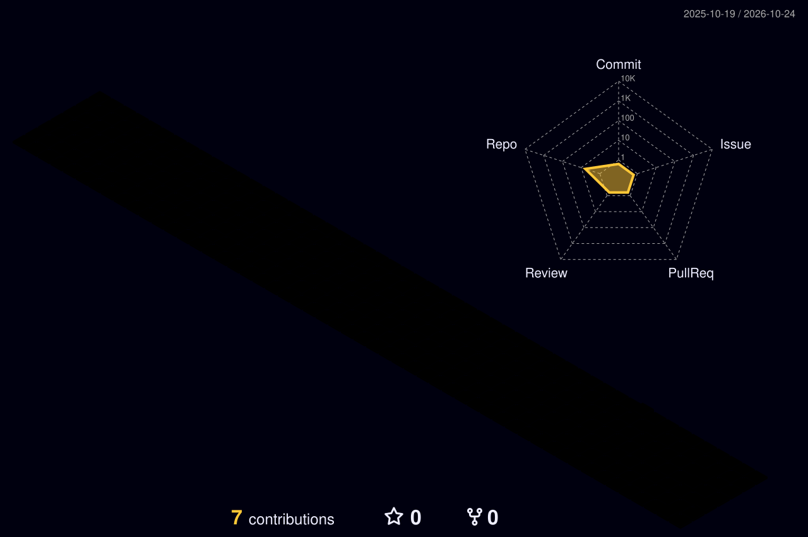

<p align="center">
  
</p>

<p align="center">
  
</p>

<p align="center">
  <a href="https://www.linkedin.com/in/pranav-jadhav-mlops"></a>
  <a href="https://huggingface.co/shreecloud"></a>
  <a href="mailto:pranav.shree96@gmail.com"></a>
</p>

<p align="center">
  <a href="https://pranavshree-ai.github.io/pranavshree-ai/">
    
  </a>
</p>
<p align="center">
  <sub>✨ <b>Click the badge above to launch the real-time 3D Vanta Fog WebGL experience, self-healing loop simulator & interactive terminal.</b></sub>
</p>

## 👋 About Me

I'm a production-focused **Machine Learning Engineer** specialising in **LLMOps, MLOps and Generative AI**. I work across the whole loop: training models in PyTorch and PyTorch Lightning, fine-tuning transformers with HuggingFace PEFT/LoRA, evaluating LLMs (AI-judge, drift detection, auto fine-tuning triggers), optimising inference (vLLM, ONNX INT8, 4-bit quantisation, sub-50ms p50) and deploying on AWS and GCP.

Right now I'm a **Data Analytics Intern (AI/ML) at Fourise Software Solutions, Pune**, where I lead the team behind **GRGPT**, a RAG assistant over 100K+ Maharashtra government documents. I'm also finishing my **MCA at DY Patil Technical Campus** (expected March 2027).

### 🎯 What Drives Me

I care about answers being **correct, not just fluent**, so I measure everything: judge agreement, latency percentiles, drift, VRAM. I like systems that notice their own degradation and fix it without a human in the loop.

**Open to full-time, internship and remote-first ML engineering roles globally.**

---

## 🚀 Featured Projects

<table>
<tr>
<td width="50%" valign="top">

### 🏛️ GRGPT
**Government Resolution & Tender RAG Assistant**

**Problem:** finding the right Maharashtra GR or tender meant slow, manual PDF search.

**Solution:** a ChatGPT-style assistant restricted to one domain (farmer schemes, scholarships, how to fill a tender), so answers stay grounded in real documents. I led the team and owned backend, RAG pipeline and model, frontend logic and verification.

**Impact**
- 100K+ PDFs indexed as **1,037,086 vectors** in a single Qdrant container
- Relevant context in **2–3 s** per query
- Tested for correctness, not just fluency

**Tech:** `Qdrant` `RAG` `Embeddings` `LLM` `Docker` `Backend APIs`

</td>
<td width="50%" valign="top">

### 📊 LLM-Eval
**Production LLM Evaluation & Observability Platform**

**Problem:** LLM quality drifts in production, and fixing it usually needs a human.

**Solution:** a dual AI-judge pipeline (Phi-3 + Claude API) with Pydantic structured scoring, Evidently AI drift detection, and a closed loop: drift alert → LoRA job → Hub push → serving hot-swap.

**Impact**
- **94%** inter-rater agreement, zero schema violations over 500+ calls
- **Sub-50ms p50**; INT8 gives **1.8×** lower latency
- **Zero human intervention** from degradation to redeploy

**Tech:** `vLLM` `FastAPI` `Evidently AI` `MLflow` `LoRA` `Docker Compose`

</td>
</tr>
<tr>
<td width="50%" valign="top">

### ⚙️ DistilBERT + Advanced MLOps
**Sentiment Classifier with a Production Platform**

**Problem:** taking a fine-tuned transformer to a safe, observable production rollout.

**Solution:** an 8-service Docker Compose platform with a Feast + Redis feature store, Nginx canary (90/10 + shadow traffic) and ONNX INT8 serving.

**Impact**
- **92.4%** accuracy on SST-2, F1 0.924
- **42ms** p50, **sub-1s** rollback
- ~**$3,000/month** compute saved at 1,000 req/s

**Tech:** `PyTorch Lightning` `Feast` `Redis` `Nginx` `ONNX` `React`

</td>
<td width="50%" valign="top">

### 🔎 RAG Document Q&A
**LangChain + Claude 3.5 Sonnet**

**Problem:** getting grounded, citable answers out of PDF and text collections.

**Solution:** Sentence-BERT embeddings, FAISS and hybrid BM25 + dense retrieval feeding Claude for grounded generation, behind a FastAPI layer with SSE streaming.

**Impact**
- **Sub-200ms** end to end (retrieve → rerank → generate)
- Chunk-level **source citations**
- Hot-swappable retriever and LLM backends

**Tech:** `LangChain` `FAISS` `BM25` `FastAPI` `Streamlit` `Docker`

</td>
</tr>
</table>

<p align="center"><sub>More: Multi-Agent Content Suite · CNN + ResNet-18 (93.7% on CIFAR-10) · Llama-3-8B LoRA with DeepSpeed ZeRO-2 (~40% lower peak VRAM)</sub></p>

---

## 🛠️ Tech Stack

<h4 align="center">Machine Learning & Deep Learning</h4>
<p align="center">
  <br>
  
  
  
  
  
</p>

<h4 align="center">LLM, RAG & Generative AI</h4>
<p align="center">
  
  
  
  
  
  
  
</p>

<h4 align="center">MLOps, LLMOps & Serving</h4>
<p align="center">
  <br>
  
  
  
  
  
  
</p>

<h4 align="center">Cloud & Data</h4>
<p align="center">
  <br>
  
  
  
  
  
  
</p>

---

## 📊 GitHub Analytics

<p align="center">
  
  
</p>

<p align="center">
  
</p>

<p align="center">
  
</p>

<p align="center">
  
</p>

---

## 🔭 Current Focus & Interests

```python
class Pranav:
    role = "Machine Learning Engineer · LLMOps · MLOps · GenAI"

    currently = {
        "work":    "Data Analytics Intern (AI/ML) @ Fourise, leading GRGPT, a RAG assistant over 100K+ govt documents",
        "study":   "MCA @ DY Patil Technical Campus (expected Mar 2027)",
    }

    going_deep_on = [
        "LLM evaluation: AI-judge scoring, drift detection, hallucination checks",
        "Closed-loop fine-tuning: drift alert -> LoRA -> redeploy",
        "Inference optimisation: vLLM, ONNX INT8, 4-bit quantisation",
        "RAG at scale: hybrid retrieval, 1M+ vector indexes",
    ]

    open_to = ["Full-time", "Internships", "Remote-first ML roles worldwide"]
```

---

## 🌍 Open Source & Community

<table align="center">
<tr>
<td align="center" width="25%"><b>🤗 HuggingFace Hub</b><br><sub>100+ downloads<br>datasets, models, model cards</sub></td>
<td align="center" width="25%"><b>🐙 GitHub</b><br><sub>8 documented ML repos<br>diagrams, Docker, CI/CD badges</sub></td>
<td align="center" width="25%"><b>✍️ Medium</b><br><sub>3+ walkthroughs, 500+ reads<br>LLM eval, RAG, MLOps</sub></td>
<td align="center" width="25%"><b>💼 LinkedIn</b><br><sub>Building in public<br>W&B dashboards, benchmarks</sub></td>
</tr>
</table>

---

## 📊 3D Contribution Graph

<p align="center">
  <picture>
    <source media="(prefers-color-scheme: dark)" srcset="profile-3d-contrib/profile-night-rainbow.svg">
    
  </picture>
</p>

---

## 🤝 Let's Connect

<p align="center"><b>Always open to discussing ML systems, LLM evaluation, or opportunities to be part of your team.</b></p>

<p align="center">
  <a href="mailto:pranav.shree96@gmail.com"></a>
  <a href="https://www.linkedin.com/in/pranav-jadhav-mlops"></a>
  <a href="https://huggingface.co/shreecloud"></a>
</p>


